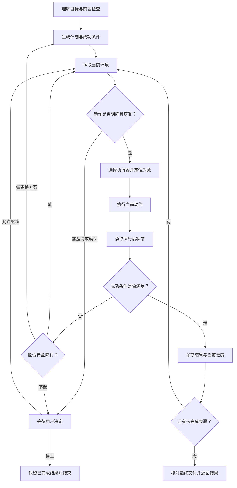

# OneLine「一句话代办」｜桌面跨软件 AI Agent 产品设计

> **让用户交代要办的事，由 Agent 管理中间流程，在关键节点保留用户决定权。**
>
> 产品原型名称：办妥。项目阶段：产品方案与可交互概念原型。当前交付：本项目文档 + [可交互原型](./OneLine-Prototype.html)。

## 1. 项目概览

| 项目要素 | 内容 |
| --- | --- |
| 解决的问题 | 用户完成跨软件办公任务时，需要同时承担重复操作、步骤规划、进度跟踪和异常处理，持续占用注意力 |
| 目标用户 | 经常使用文件、表格和邮件处理重复任务的办公用户，优先聚焦报销材料整理与发送场景 |
| 核心方案 | 用自然语言接收任务目标，通过任务规划、跨软件执行、结果检查和关键节点确认，交付完整任务结果 |
| 核心案例 | 将下载目录中的发票整理并重命名，生成报销清单，准备邮件，在用户确认后发送 |
| 产品工作范围 | 场景分析、MVP 范围定义、Agent 能力与运行机制设计、用户交互设计、验证指标与迭代方案 |
| 已形成的产出 | 5 阶段可交互原型；自主性与风险分级规则；执行与验证闭环方案；5 维产品验证框架 |
| 当前实现边界 | 原型通过前端脚本与固定数据模拟任务流程，尚未接入真实 LLM、桌面控制、文件处理和邮件服务 |

**项目价值假设：** 如果 Agent 能可靠承接目标明确、结果可检查的跨软件任务，并在外部发送等关键节点保留用户控制权，就有机会减少用户的主动操作时间和持续监督负担。当前阶段通过原型表达方案，实际效率与可靠性仍需真实执行和用户试用验证。

## 2. 用户究竟遇到了什么问题

### 2.1 从一项报销任务看用户负担

用户想完成的事情是：

> 把下载目录里本周的发票整理好，生成报销清单，并发给财务。

为了完成这个目标，用户通常需要查找文件、判断日期、创建文件夹、整理与重命名、提取金额、填写表格、创建邮件、选择附件、核对收件人，最后发送。过程中会在文件管理器、表格工具和邮件应用之间反复切换。

| 用户负担 | 具体表现 | 带来的问题 |
| --- | --- | --- |
| 重复操作 | 查找、复制、重命名、录入、添加附件 | 操作繁琐，容易遗漏或填错 |
| 维持任务上下文 | 记住哪些文件处理过、清单是否完整、邮件应附哪些材料 | 软件切换后需要重新确认进度 |
| 管理执行流程 | 判断下一步、核对结果、处理加载失败或文件冲突 | 用户需要持续盯着任务，难以转去处理其他工作 |
| 承担错误后果 | 错发附件、覆盖文件、发错收件人 | 即使交给助手执行，也可能仍要逐步监督 |

如果助手每次只响应“打开文件夹”“填写表格”“添加附件”等指令，用户仍然要负责组织整条流程。**本项目希望减少的，是完成任务所需的操作和流程管理负担。**

### 2.2 用户期待的完成结果

用户需要拿到可检查的交付物：整理后的发票、对应的报销清单，以及可确认的邮件状态。同时，用户应知道哪些动作已经完成、哪些动作还需要决定，出现异常时也能理解当前卡在哪里。

因此，产品应同时做到三件事：承担中间步骤；提供足够的进度与结果信息；在会产生重要影响的动作前让用户决定。

以上问题来自现有材料中的场景分析，尚未通过正式访谈或用户实验确认发生频率与影响大小，属于待验证的需求假设。

## 3. 为什么选择这个 MVP 场景

### 3.1 优先选择“发票整理—清单生成—邮件发送”

| 选择依据 | 对产品验证的意义 |
| --- | --- |
| 目标明确 | 可以识别输入对象、处理规则、输出材料和收件人 |
| 覆盖多个环境 | 文件、表格、邮件构成连续任务，能够展示跨软件上下文维护 |
| 存在重复劳动 | 文件整理和字段汇总具有代办价值 |
| 结果可检查 | 可以核对文件数量、清单字段、金额汇总、附件和邮件状态 |
| 含关键决策节点 | 邮件发送有外部影响，适合验证自主执行与用户控制如何衔接 |

这个场景可以用一条完整任务链，同时检验理解、规划、执行、验证与用户确认，避免初期被大量软件适配和主观质量评价分散。

### 3.2 明确第一阶段的范围

| 范围 | 本项目的产品选择 |
| --- | --- |
| 核心任务 | 指定目录内的发票整理、按规则命名、生成清单、准备并确认发送邮件 |
| 输入约束 | 用户授权的目录；明确的时间范围与命名规则；可唯一识别的收件人 |
| 处理原则 | 优先保留原文件，以复制或生成新版本降低覆盖与丢失风险 |
| 输出要求 | 整理后的文件、字段可核对的清单、准确的邮件处理状态与执行记录 |
| 后续扩展 | 合同分类、网页信息汇总、PPT 调整，以及更多操作系统与软件版本 |
| 暂不自主承接 | 付款、交易、账号安全设置修改，以及不能可靠控制后果的操作 |

原型首页展示的合同整理和 PPT 调整用于表达后续场景方向，当前交互只演示发票任务。发票信息汇总也不等同于财务合规审核，清单需保留来源，便于核对。

## 4. 产品方案：把目标变成可交付的任务

### 4.1 五个用户阶段

界面围绕用户在每个阶段需要理解和决定的事情组织，后台的规划、感知与验证则支撑这些体验。

| 用户阶段 | 用户关心什么 | 产品提供什么 | 原型中的交互 |
| --- | --- | --- | --- |
| 描述目标 | 我想办什么事？ | 自然语言输入与任务示例 | 输入目标，点击“交给办妥” |
| 理解与规划 | 理解对了吗，准备怎么做？ | 任务对象、交付物、执行路径、关键确认点 | 查看计划，返回修改或开始执行 |
| 执行任务 | 做到哪里，是否需要我？ | 当前步骤、文件／表格／邮件路径、可展开记录 | 观察进度、查看记录、停止后续执行 |
| 必要确认 | 接下来会发生什么，我是否同意？ | 收件人、主题、附件与发送影响 | 确认发送，或暂不发送并保留草稿 |
| 交付结果 | 最后办成了什么？ | 文件整理、清单、邮件状态与执行记录 | 查看结果与记录，新建代办 |

### 4.2 关键交互判断

**让用户确认理解，避免逐步指挥。** 原型保留一次计划总览与“开始执行”，便于用户检查目标和范围；进入执行后，明确的低风险步骤连续进行。未来可测试是否需要每次都展示计划，或只在首次使用、任务复杂或信息不完整时展开。

**把过程信息按需展开。** 默认展示当前进展与交付物，将详细记录收起。用户可以确认事情正在推进，也可以在出现问题时追溯过程。

**在动作发生前交还决定权。** 邮件准备好后再展示收件人和附件，让用户针对具体结果作出决定。用户无需批准每一次查找或录入操作。

**用结果状态结束任务。** 发送成功与保存草稿应分别反馈；用户选择暂不发送时，已经准备的材料仍然有价值，但原始“整理并发送”目标尚未全部完成。

原型的完整发送路径包含“提交目标、开始执行、确认发送”三个主要点击。“用户介入 1 次”表示执行启动后的关键发送决策，不能解释为全程只有一次操作；正式验证需分别统计启动操作、必要决策和额外求助。

## 5. Agent 机制：自主执行如何保持可靠与可控

本节描述目标运行方案。现有前端原型通过固定脚本模拟这些行为，尚未实现真实 Agent 执行链路。

### 5.1 模块职责

| 模块 | 职责 | 对用户价值的支撑 |
| --- | --- | --- |
| Task Understanding 任务理解 | 提取目标、对象、时间范围、处理规则、收件人与预期交付 | 减少理解偏差，把自然语言转为可检查的任务 |
| Pre-check 前置检查 | 检查能力、信息、权限与风险，发现歧义时补充信息 | 避免带着缺失信息开始执行 |
| Planner 任务规划 | 拆解步骤、确定依赖关系与成功条件 | 承担用户原本需要维护的流程 |
| Executor Router 执行器调度 | 为当前步骤选择文件接口、应用接口或 GUI 操作 | 用合适的工具完成实际操作 |
| Observer 环境感知 | 获取执行前后文件、界面和应用状态 | 提供动作是否生效的证据 |
| GUI Grounding 控件定位 | 根据当前界面识别目标控件，并判断是否可以操作 | 降低界面变化导致的误操作 |
| Verifier 结果验证 | 检查单步后置条件及最终交付是否满足目标 | 避免上一步失败后继续放大错误 |
| Risk Gate 风险控制 | 每个重要动作执行前检查授权与风险，必要时暂停 | 保留对外发送、覆盖等动作的决定权 |
| State / Execution Log 状态与记录 | 保存当前步骤、已完成结果、异常与用户决定 | 支撑进度展示、恢复执行与质量分析 |

LLM 负责理解和规划；执行器负责实际操作；结果验证需要依赖可观察的证据。即使模型认为任务已完成，也需要检查文件、附件或发送状态。

### 5.2 执行与验证闭环

风险判断放在动作执行前；GUI 操作先读取当前界面，再定位控件；执行后再次感知并检查。重试与重规划应有次数或耗时上限，不能无限循环。

### 5.3 用成功条件定义“完成”

| 步骤 | 需要检查的成功条件 |
| --- | --- |
| 查找发票 | 文件来自授权目录，符合确认后的时间筛选规则，待处理清单可追溯 |
| 整理与命名 | 目标文件存在、数量与待处理清单一致、命名符合规则、原文件未被误覆盖 |
| 生成清单 | 文件可以读取，字段与源发票对应，金额汇总一致；无法识别的字段明确标记 |
| 准备邮件 | 收件人唯一且正确，附件来自当前任务，主题与内容符合要求 |
| 发送邮件 | 获得针对当前收件人与附件的授权，存在应用或接口返回的发送证据 |
| 最终交付 | 返回文件位置、清单与邮件状态；遗漏、失败和未发送部分明确呈现 |

后续主观任务可以采用两层验收：系统检查文件生成、可打开与内容完整性，用户判断效果是否满意。当前 MVP 优先使用客观结果可检查的任务。

### 5.4 自主性按风险与不确定性调整

| 等级 | 条件与示例 | 产品行为 |
| --- | --- | --- |
| A：自主执行 | 目标明确、授权范围内、易恢复，例如读取文件、创建文件夹、生成清单 | 连续执行并验证结果，避免逐步询问 |
| B：关键节点确认 | 发送邮件、覆盖已有文件、删除重要资料等可能产生较大影响的动作 | 先完成准备，展示具体对象与后果，确认后执行 |
| C：澄清、降级或停止 | 联系人不唯一、缺少权限、环境无法可靠操作，或风险超出支持范围 | 澄清信息、请求用户处理环境问题，或停止自主执行 |

风险与不确定性分别检查：读取文件虽然风险低，但目录不明确时仍需澄清；邮件字段即使完整，对外发送仍需确认。若确认后的收件人或附件发生变化，需要重新确认。

## 6. 异常与设备差异：任务如何继续

### 6.1 按异常性质选择恢复方式

| 异常 | 目标处理策略 | 用户何时介入 |
| --- | --- | --- |
| 页面加载慢、控件暂不可用 | 等待并重新感知，在上限内重试 | 超过恢复上限时说明当前问题 |
| 文件名冲突 | 使用不覆盖原文件的新名称并记录映射 | 必须覆盖或规则无法确定时 |
| 发票字段无法识别 | 标记不确定字段，保留来源，避免凭空填写 | 需要补充或核对关键字段时 |
| 多个“小王” | 展示联系人候选，等待选择 | 识别到歧义时立即介入 |
| 邮件未登录、缺少权限 | 保存进度，暂停任务 | 用户完成登录或授权后继续 |
| 软件弹窗、界面变化 | 重新定位或切换支持的执行方式 | 无法判断弹窗或恢复失败时 |
| 发送超时、结果未知 | 先查询发送记录，确认状态后再决定 | 无法确认时告知用户，避免直接重复发送 |

恢复需要保存任务目标、当前步骤、已生成文件、验证结果和用户授权。继续执行时从经验证的进度接续，已完成的文件生成不重复运行；发送等外部动作需额外核对是否已经生效。

上述恢复机制属于运行设计，当前原型未接入真实异常检测与断点续跑。

### 6.2 优先把设备差异收敛到执行适配层

同样是“创建邮件并添加附件”，操作系统、软件版本、窗口尺寸和语言会改变控件与状态反馈。因此扩展设备覆盖时，优先改造环境识别、执行器适配、GUI 定位和结果感知。

在可用、已授权且符合任务要求的前提下，优先使用系统／应用接口；再考虑可访问性树或 DOM；需要时使用视觉定位与 GUI 操作。上层 Planner 尽量描述要完成的动作，适配层负责在当前环境中执行并返回证据。若当前环境不具备必要能力，前置检查和计划也必须随之调整。

## 7. 原型交付与演示方式

### 7.1 当前已实现与尚未实现的能力

| 能力 | 当前交付状态 |
| --- | --- |
| 五阶段页面切换与计划总览 | 已有可交互前端 |
| 文件—表格—邮件的执行进度展示 | 已有固定脚本与示例预览 |
| 发送前暂停、确认发送、暂不发送分支 | 已有模拟交互 |
| 执行记录展开、停止后续步骤、新建代办 | 已有前端交互 |
| 任意任务的理解与动态规划 | 未实现；输入内容不会驱动新的执行计划 |
| 真实文件扫描、发票提取、表格生成、邮件发送 | 未接入；界面中的文件与发送状态均为示例 |
| 重试、重规划、权限处理、断点续跑 | 已定义目标策略，未实现真实执行 |
| 实际效率提升、任务成功率、用户再次委托 | 已设计验证方案，尚无实测数据 |

原型中的“本地执行环境正常”、5 份发票、示例金额、完成步骤及用户介入次数用于演示产品信息结构，不能作为真实连接状态或业务测试结果。现有示例日期与“本周”也是固定场景内容。

### 7.2 推荐演示路径

1. 用浏览器打开同目录中的 `OneLine-Prototype.html`。该版本已内嵌原有样式和脚本，不需要安装环境或配置 API Key。
2. 使用默认发票任务，点击“交给办妥”，查看任务对象、交付物、执行路径和确认点。
3. 点击“开始执行”，观察文件整理、清单生成和邮件准备的连续进度，可展开执行记录。
4. 到达确认页，检查收件人、主题和附件，再选择“确认发送”。
5. 查看模拟发送后的验证过程与最终交付结果。

如需展示“暂不发送”分支，刷新页面后重新进入任务，并在确认页选择暂不发送；结果页会展示保留草稿的状态。建议每条分支从刷新后的初始状态开始，以免上一轮演示状态影响展示。

本次仅将原 HTML、CSS、JavaScript 封装为单文件，保留现有视觉与交互。选择文件夹等未绑定实际能力的入口仅为展示元素。

## 8. 产品验证：怎样证明值得委托

### 8.1 分开验证交互、执行和用户价值

| 层级 | 验证问题 | 方法与产出 |
| --- | --- | --- |
| 原型可用性 | 用户能否理解目标、计划、暂停原因和结果？ | 邀请目标用户完成演示，观察误解、犹豫和关键确认遗漏 |
| 真实执行可靠性 | Agent 能否正确处理文件、表格与邮件，并在异常下保持可控？ | 接入真实执行后建立标准任务集与异常注入测试，记录结果证据 |
| 实际用户价值 | 用户是否减少操作和监督，是否愿意再次委托？ | 对比人工与 Agent 模式，测量主动操作时间、修正负担和委托意愿 |

原型流程走通能支持交互方案评审，真实跨软件能力与用户价值必须通过后两层验证。

### 8.2 五维指标与建议门槛

以下均为后续受控试用的**拟定指标和目标**，尚未达到或经过测试，需根据任务难度、样本规模和风险评估校准。

| 维度 | 核心指标与口径 | 初期建议目标 |
| --- | --- | --- |
| Completion 完成能力 | 端到端成功率＝全部交付正确且无严重副作用的任务数／有效测试任务数 | ≥90% |
| Completion 结果质量 | 文件、字段、金额、收件人、附件与发送证据逐项核对；另统计关键步骤成功率 | 关键步骤成功率 ≥95% |
| Autonomy 自主性 | 人工操作减少率＝（人工模式用户操作数－Agent 模式用户操作数）／人工模式用户操作数 | ≥70%，同时记录额外求助次数 |
| Control 可控性 | 未授权高风险动作数，以及错发、误覆盖、重复发送等严重副作用 | 测试期间两者均为 0；出现即阻断扩大试用 |
| Robustness 鲁棒性 | 自动恢复率＝无人工帮助恢复的异常数／预先定义的可自动恢复异常数 | ≥90%，按异常类别报告 |
| User Value 用户价值 | 主动操作时间减少率＝（人工主动操作时间－Agent 主动操作时间）／人工主动操作时间 | ≥50% |
| User Value 委托意愿 | 表示愿意再次委托的用户数／完成试用并作答的用户数 | ≥80%；后续另测实际再次使用 |

用户主动操作时间包括任务描述、计划检查、关键确认、结果核对及纠错，避免只计算点击时间。另记录端到端完成时间和等待体验，防止 Agent 虽节省操作却产生过长等待。

必要的发送确认不计为多余打扰；用户拒绝发送应记录为“用户选择保留草稿”，不能包装为原始发送任务成功，也不直接归为执行器故障。小样本中未观察到严重错误，不代表长期风险为零。

### 8.3 测试设计与迭代依据

真实执行接入后，拟建立 30–50 个受控任务，优先覆盖核心发票场景的数量、命名、联系人与附件变化，并注入文件冲突、未登录、页面加载慢和发送状态未知等异常。发送测试使用专用账号和测试收件人。

用户价值验证拟邀请 10–20 名目标用户，让每人分别用人工与 Agent 完成难度相近的不同任务，随机安排先后顺序，减少个体差异和练习效应。初期用于发现体验问题与估计价值，不作大规模效果结论。

日志应记录任务与步骤标识、时间、目标对象、执行方式、结果证据、重试、用户确认及最终状态。依据失败发生位置决定迭代：理解错误优先改输入与澄清；GUI 步骤失败优先改定位与适配；验证漏判优先改成功条件；频繁求助优先改恢复策略；正确率达标但不愿使用则回到场景与体验。

可控性作为独立门槛，不能用其他指标的高分抵消。原材料中的效率数字与建议门槛均保留为设计示例或待验证目标，不写入简历的实际成果。

## 9. 当前成果与 AI 产品经理能力

| 能力 | 本项目中的具体体现 | 可供评审的证据 |
| --- | --- | --- |
| 问题定义 | 将办公任务拆为操作、上下文维护、流程管理与错误后果四类负担 | 用户问题与案例分析 |
| MVP 判断 | 聚焦跨软件、重复操作、结果可检查且含确认节点的发票场景 | 场景选择依据与范围表 |
| AI 能力设计 | 明确理解、规划、执行、感知、验证的职责，定义动作成功条件 | Agent 闭环与验收表 |
| 人机协作设计 | 按风险和不确定性调整自主程度，区分准备与正式发送 | 自主性分级与确认交互 |
| 产品交互设计 | 将运行模块映射为五个用户阶段，按需展开过程信息，交付结果 | 可交互原型 |
| 可靠性判断 | 定义异常恢复、进度保存、发送状态核对和设备适配策略 | 异常与适配方案 |
| 指标与验证设计 | 同时评估完成、自主、控制、恢复和用户价值，区分方案与实测 | 指标口径与测试设计 |

当前成果是将用户问题、Agent 机制、用户交互与验证方案连接为一个可评审的产品设计项目。后续优先接入真实文件与清单生成，再验证受控邮件发送及恢复能力；通过受控任务测试后进入用户试用。

## 10. 简历项目描述

**OneLine「一句话代办」｜桌面跨软件 AI Agent 产品设计与原型**

- 针对跨软件办公中的重复操作与流程管理负担，定义“发票整理—清单生成—邮件发送”MVP，明确目标用户、任务范围及可核验交付。
- 设计任务理解、规划、执行、感知与验证闭环，以及分级自主执行、关键节点确认、异常恢复和执行适配方案，平衡代办效率与用户控制权。
- 形成 HTML/CSS/JavaScript 五阶段可交互概念原型，覆盖执行进度、发送确认、草稿保留与结果展示；建立完成能力、自主性、可控性、鲁棒性和用户价值五维验证框架。

**使用口径：** 当前按“产品设计与概念原型”陈述；真实跨软件执行、用户规模、成功率和效率提升在取得证据后再补充。

## 附：材料整合依据

| 原始材料 | 在本项目文档中的用途 |
| --- | --- |
| 「一句话代办」PRD.md | 用户问题、产品机会、目标用户与初期范围 |
| 「一句话代办」能力说明.pdf | 能力边界、自主性分级与用户介入原则 |
| 「一句话代办」运行设计说明.pdf | 执行器职责、感知与验证、任务状态和执行记录 |
| 「一句话代办」验证说明.md | 五维验证框架、任务集与用户试用方案 |
| 交互修改说明.md | 用户视角、渐进式披露与结果交付原则 |
| 面向更复杂设备环境的模块重设计.md | 环境识别、能力路由与执行适配策略 |
| UserFacing.html / UserFacing.css / UserFacing.js | 原型现状、演示路径及已实现交互边界 |
| PewReadMe.md | 通用前端模板使用说明，不作为业务需求或真实执行能力的证据 |

整合时将主观任务放入后续扩展，明确风险检查在动作之前，细化发送状态未知时的恢复与指标口径；这些属于方案完善，不代表新增后端实现或新增实测成果。
